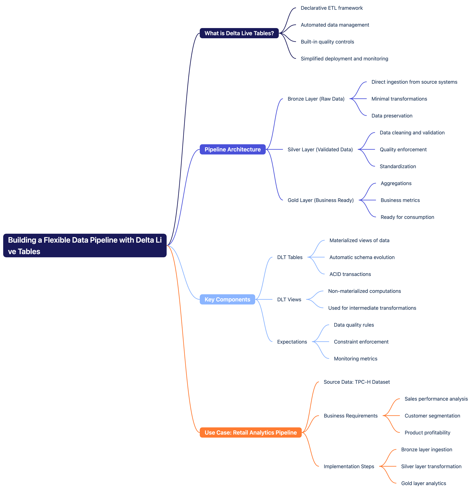

# [Retail Analytics Delta Live Tables Pipeline](https://medium.com/@santosh-shinde/how-to-create-a-flexible-data-pipeline-with-delta-live-tables-1e03bf5481f9)

This repository contains a Delta Live Tables (DLT) pipeline implementation for retail analytics using the TPC-H dataset. The pipeline implements a medallion architecture with Bronze, Silver, and Gold data layers to process and analyze retail data.

## Table of Contents

- [Retail Analytics Delta Live Tables Pipeline](#retail-analytics-delta-live-tables-pipeline)
  - [Table of Contents](#table-of-contents)
  - [Overview](#overview)
  - [Architecture](#architecture)
    - [1. Bronze Layer](#1-bronze-layer)
    - [2. Silver Layer](#2-silver-layer)
    - [3. Gold Layer](#3-gold-layer)
  - [Pipeline Mindmap](#pipeline-mindmap)
  - [Prerequisites](#prerequisites)
  - [How to Run](#how-to-run)
  - [Pipeline Components](#pipeline-components)
    - [Bronze Tables](#bronze-tables)
    - [Silver Tables](#silver-tables)
    - [Gold Tables](#gold-tables)
  - [Data Flow](#data-flow)
  - [Dependencies](#dependencies)
  - [Advanced Features](#advanced-features)
  - [Monitoring and Maintenance](#monitoring-and-maintenance)
  - [References](#references)
    - [Connect with me on](#connect-with-me-on)

## Overview

This Delta Live Tables pipeline processes retail data from the TPC-H dataset to create analytics-ready tables for business intelligence and data science use cases. It follows a modern data engineering approach with clearly defined layers of data processing.

## Architecture

The pipeline follows the medallion architecture with three distinct layers:

### 1. Bronze Layer

- Ingests raw data from source systems with minimal transformation
- Preserves the original data for auditing and lineage purposes
- Tables: `bronze_customers`, `bronze_orders`, `bronze_lineitem`

### 2. Silver Layer

- Cleanses, validates, and enriches data from the bronze layer
- Implements data quality expectations
- Standardizes data formats
- Tables: `silver_customers`, `silver_orders`, `silver_lineitem`

### 3. Gold Layer

- Creates business-ready, aggregated tables for analytics and reporting
- Implements domain-specific transformations and calculations
- Tables: `gold_customer_orders`, `gold_monthly_sales`, `gold_product_performance`

## Pipeline Mindmap

The following mindmap illustrates the structure and data flow of the Delta Live Tables pipeline:



*The mindmap provides a visual representation of the pipeline components, data flow, and relationships between different tables and processing stages.*

## Prerequisites

- Databricks workspace with Unity Catalog enabled
- Access to the TPC-H sample dataset (`samples.tpch`)
- Databricks Runtime 11.0 or above with Photon enabled (recommended)
- Appropriate permissions to create and run Delta Live Tables pipelines

## How to Run

1. **Import the Notebook**:

   - Import the `dlt_pipeline.ipynb` notebook into your Databricks workspace

2. **Create a DLT Pipeline**:

   - Navigate to the **Workflows** sidebar in your Databricks workspace
   - Click on **Delta Live Tables** and then **Create Pipeline**
   - Fill in the following details:
     - **Pipeline Name**: Retail Analytics Pipeline
     - **Notebook Libraries**: Select the path to your imported `dlt_pipeline.ipynb`
     - **Target**: Specify your target database (e.g., `retail_analytics`)
     - **Storage Location**: Specify a DBFS path to store your tables
     - **Pipeline Mode**: Select either Continuous or Triggered based on your use case
     - **Enable Photon Acceleration**: Recommended for better performance

3. **Run the Pipeline**:

   - Click **Create** to create the pipeline
   - Click **Start** to execute the pipeline
   - Monitor the pipeline execution in the DLT UI

4. **Access the Data**:
   - Once the pipeline completes, you can access the data using SQL queries:
   ```sql
   SELECT * FROM retail_analytics.gold_monthly_sales
   ```

## Pipeline Components

### Bronze Tables

- **bronze_customers**: Raw customer data from TPC-H dataset
- **bronze_orders**: Raw orders data from TPC-H dataset
- **bronze_lineitem**: Raw lineitem data from TPC-H dataset

### Silver Tables

- **silver_customers**: Cleaned and validated customer data
- **silver_orders**: Cleaned and validated orders data
- **silver_lineitem**: Cleaned and validated lineitem data with calculated revenue

### Gold Tables

- **gold_customer_orders**: Customer orders summary for analytics
- **gold_monthly_sales**: Monthly sales aggregated by market segment
- **gold_product_performance**: Product performance analysis with revenue metrics

## Data Flow

1. Raw data is ingested from the TPC-H sample dataset into bronze tables
2. Data is validated and cleaned in the silver layer
   - Invalid records are identified but preserved for auditing
   - Data quality expectations are applied (e.g., valid keys, valid prices)
3. Business-ready gold tables are created by:
   - Joining related tables (e.g., customers and orders)
   - Calculating metrics (e.g., total sales, order count)
   - Aggregating data by dimensions (e.g., market segment, time periods)

## Dependencies

- PySpark: For data processing and transformation
- Delta Lake: For reliable data storage and ACID transactions
- Delta Live Tables: For declarative pipeline definition and orchestration

## Advanced Features

This pipeline demonstrates several advanced DLT features:

- Data quality expectations using `@dlt.expect_all`
- Table comments for better documentation
- Data enrichment and transformation
- Creating aggregated analytical views

## Monitoring and Maintenance

- Monitor pipeline health in the DLT UI
- Check data quality metrics in the Data Quality tab
- Review pipeline events and logs for troubleshooting
- Schedule pipeline refreshes based on your data freshness requirements

## References

- [How to Create a Flexible Data Pipeline with Delta Live Tables](https://medium.com/@santosh-shinde/how-to-create-a-flexible-data-pipeline-with-delta-live-tables-1e03bf5481f9)
- [Databricks Delta Live Tables Documentation](https://docs.databricks.com/delta-live-tables/index.html)
- [Medallion Architecture](https://www.databricks.com/glossary/medallion-architecture)
- [TPC-H Benchmark](http://www.tpc.org/tpch/)

<hr/>

### Connect with me on

<div id="badges">
  <a href="https://twitter.com/shindesan2012">
    
  </a>
  <a href="https://www.linkedin.com/in/shindesantosh/">
    
  </a>
   <a href="https://blog.santoshshinde.com/">
    
  </a>
  <a href="https://www.buymeacoffee.com/santoshshin" target="_blank">
    
  </a>
</div>